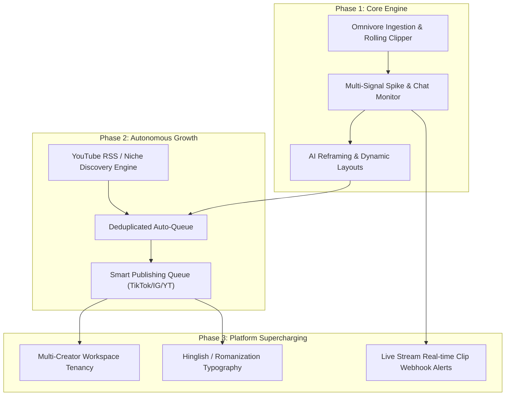

# OpenShorts: Competitive Gap Analysis & Supercharged Roadmap

## Executive Summary
OpenShorts represents the state of the art in vertical video reframing, multi-shot layout generation (split 2-shot conversation, screencast + presenter, webcam inset), and multimodal Gemini video analysis. 
By synthesizing the architectures and unique strengths of **ClippyMe**, **PeakCut**, and **Shorts Autopilot**, OpenShorts has been expanded into an undisputed end-to-end autonomous video platform featuring real-time live stream clipping, autonomous channel monitoring, AI niche discovery, multi-platform scheduled publishing queues, and non-speech hype detection.

---

## 1. Competitive Gap Analysis Matrix

| Capability Dimension | OpenShorts (Baseline) | ClippyMe | PeakCut | Shorts Autopilot | OpenShorts (Supercharged) |
| :--- | :--- | :--- | :--- | :--- | :--- |
| **Ingestion & Sources** | Single YouTube URL or file upload | YouTube, Twitch, Kick, direct uploads | YouTube, Twitch, Kick live streams & VODs | YouTube Data API, local runs, uploads | **Unified Omnivore**: YouTube VODs/Lives, Twitch, Kick, RSS feeds, direct uploads |
| **Live Stream Capture** | None (Post-broadcast only) | Fixed-segment stream polling | Circular MPEG-TS buffer (6s segments) + raw PCM | None | **Dual-Pipe Rolling Clipper**: Circular TS buffer + RMS loudness + anonymous Twitch IRC listener |
| **Audio-Energy Detection** | None (Transcript-only) | FFmpeg silence/filler detection | Dual-judge (words + loudness/chat z-scores) | Audio-energy envelope RMS + convolution hype filter | **Multi-Signal Hype Engine**: Audio RMS spikes, Twitch chat velocity, spoken trigger phrases, sports/gaming hype detector |
| **Channel Monitoring** | Manual input / REST API | Async multi-channel live/VOD monitor | Background 2-min polling across YouTube/Twitch/Kick | Hourly cron execution | **Autonomous Channel Watcher**: Dual-mode (Live auto-clipper + VOD RSS zero-quota feed poller) |
| **Autonomous Discovery** | None | None | None | YouTube Data API two-hop search + topic providers | **Niche Discovery Engine**: Pluggable providers (trending, sports, seeds) + persistent seen ledger + auto-enqueue |
| **Framing & Reframing** | **Industry Best**: TRACK, GENERAL, SPLIT, SCREENCAST, INSET, PUNCH-IN | Comfort mode, stationary lock, OneEuro / Kalman RTS | Lanczos crop, blurred background | MediaPipe FaceMesh lip MAR + EMA pan | **Unmatched Suite**: Multi-speaker, screencast width-gating, webcam insets + stationary lock support |
| **Subtitles & Kinetic ASS** | ASS karaoke, custom fonts, split-seam dynamic placement | 6 animated presets, semantic line-breaking | Vector graphic box drawing in ASS, TTF binary parser | libass karaoke, 3 words/screen, active color fill | **Elite Typography**: Dynamic split-layout seam positioning, ASS vector drawing, word-level pop animations |
| **Social Publishing & Scheduling** | Single-post Upload-Post API | Intent journal, 30s rate spacing, daily roll | Next-slot scheduler, post gap, daily caps | Resumable YouTube upload, uploaded ledger | **Smart Publishing Queue**: Platform-specific rate limiting, minimum gap spacing, daily caps, auto-roll to 9AM, exponential backoff |
| **Agent / MCP Integration** | Remote Streamable-HTTP JSON-RPC at `/mcp` | None | None | None | **Extended MCP Suite**: 13 first-class agent tools for discovery, monitoring, clipping, reframing, and publishing |

---

## 2. Implemented Supercharged Modules in OpenShorts

### 1. `live_clipper.py` — Live Stream Rolling Buffer Clipper
- **Stream Ingestion**: Resolves HLS/DASH/RTMP streams from YouTube Live, Twitch, and Kick via `yt-dlp`.
- **Rolling Circular Buffer**: FFmpeg segments video into 6-second MPEG-TS chunks while bounding disk consumption by unlinking chunks older than `buffer_minutes`.
- **Dual Stream Pipe**: Simultaneously captures raw mono 16kHz PCM audio to memory to calculate decibel RMS loudness per second.
- **Anonymous Twitch IRC Chat Monitor**: Connects anonymously to `irc.chat.twitch.tv:6697` to measure real-time chat velocity without OAuth setup.
- **Multi-Signal Hype Triggers**: Fires automatic clip extractions when audio loudness jumps $\ge 60\%$ over baseline or chat velocity doubles. Supports spoken ("clip it") and manual clip triggers.

### 2. `niche_discovery.py` — Autonomous Niche & Topic Discovery Engine
- **Two-Hop YouTube Discovery**: Queries `search.list` for candidate video IDs, followed by batch `videos.list` for duration and viewCount statistics.
- **Zero-API-Key Fallback**: Transparently falls back to `yt-dlp` playlist search if `YOUTUBE_API_KEY` is not present.
- **Pluggable Topic Providers**: Built-in providers for viral trending niches (`youtube_trending`), sports reactions (`sports`), and custom keyword seeds (`seeds`).
- **Deduplication Ledger**: `output/seen_sources.json` tracks clipped videos to guarantee repeat runs never process identical sources.

### 3. `channel_watcher.py` — Autonomous Multi-Platform Channel Monitor
- **Multi-Platform**: Monitors channels across YouTube (@handles, channel IDs), Twitch, and Kick.
- **Dual Mode**:
  - `live`: Detects broadcast start and triggers the rolling buffer live clipper.
  - `vod`: Parses public YouTube RSS Atom feeds (`/feeds/videos.xml?channel_id=...`) with **zero API quota consumption** to discover new uploads and pass them to OpenShorts' processing queue.
- **State Persistence**: `output/channel_watcher.json` stores channel states and last-seen IDs.

### 4. `publishing_queue.py` — Smart Multi-Platform Publishing Queue & Scheduler
- **Multi-Platform Support**: YouTube Shorts, TikTok, and Instagram Reels.
- **Smart Slot Spacing**: Enforces minimum spacing gaps (e.g., 45-60 min) between consecutive posts on the same account.
- **Daily Post Caps & Morning Rollover**: Automatically schedules posts for 9:00 AM the next day once daily post quotas are reached.
- **Exponential Backoff**: Retries failed dispatches with progressive backoff delays (handling 429 rate limits gracefully).

### 5. `highlight_detector.py` — Non-Speech Audio-Energy Highlight Detector
- **Excitement Detection**: Uses audio RMS energy envelope convolution smoothing to capture sustained roar/cheer peaks (goals, esports plays, stunts).
- **Percentile Thresholding**: Adaptive spike detection with minimum spacing suppression.
- **Blurred-Pad Integration**: Emits cut definitions ready for OpenShorts' `GENERAL` blurred 9:16 background layout.

### 6. `supercharged_routes.py` & `mcp_server.py` Integration
- Mounted REST endpoints under `/api/live/*`, `/api/discover/*`, `/api/channels/*`, `/api/queue/*`, and `/api/highlights/*`.
- Added 5 new agent tools to OpenShorts' FastMCP server:
  - `discover_trending_videos`
  - `watch_channel`
  - `start_live_clipper`
  - `schedule_publish`
  - `detect_audio_highlights`

### 7. PeakCut Web UI Integration & Compatibility Bridge (`peakcut_bridge.py`)
- **Primary Root UI**: PeakCut's reactive studio UI ([web/index.html](file:///D:/yt/web/index.html)) is served directly at `/` (root URL), `/app`, `/app/{rest:path}`, and `/studio`. Opening the web server root immediately loads the PeakCut Studio!
- **Landing Page**: Animated ASCII landing page served at `/landing`.
- **Brand & Script Delivery**: Serves SVG brand assets (`/brand/{name}`) and scripts (`/assets/{name}`).
- **Sync & Heartbeat Engine**: Serves `/api/status`, `/api/sync?v={token}`, and `/api/overview` with zero-latency tokenized polling.
- **Creator Workspaces**: Dedicated workspaces per creator/channel with custom rules, target platforms, custom spoken triggers, ROI rate calculations, and presets ([creator_workspaces.py](file:///D:/yt/creator_workspaces.py)).
- **Hardware Telemetry**: Real-time OS telemetry monitoring CPU, RAM, GPU, and disk without external dependencies ([system_telemetry.py](file:///D:/yt/system_telemetry.py)).
- **Multi-Channel Alerts**: Discord Webhook and Telegram Bot dispatch with Windows sleep prevention keep-awake loops ([alerts_dispatcher.py](file:///D:/yt/alerts_dispatcher.py)).
- **Hinglish/Romanization Engine**: Pure-Python phonetic transliteration for Devanagari Hindi and Urdu with schwa deletion ([romanization.py](file:///D:/yt/romanization.py)).
- **Media Delivery**: Seamless streaming and serving of rendered video clips and covers via `/media/{jid}/{name}`.
- **UI Operational Handlers**: Operational backend endpoints for `/api/feedback`, `/api/updates`, `/api/tour`, `/api/bulk/delete`, and clip deletion.

### 8. Killer Editing & Algorithmic Modules Added
- **`smartcut.py` (Auto-Silence Jump Cutter)**: Detects silence gaps with FFmpeg `silencedetect` and cuts dead air with 50ms/80ms padding and 30ms audio cross-fades to dramatically tighten video pacing.
- **`color_grade.py` (Visual Color Grading)**: Applies viral vertical presets (`vibrant_pop`, `warm_cinema`, `moody_dark`, `clean_contrast`, `cyberpunk_neon`) with saturation, contrast, unsharp, and vignette filtergraphs.
- **`branding_overlay.py` (Logo & Watermark Overlay Engine)**: Overlays brand watermarks and logos at customizable anchor positions with opacity and width scaling.
- **`topic_segmenter.py` (Marti Hearst TextTiling)**: Lexical cohesion and cosine similarity depth-valley analysis to segment long podcast transcripts into complete, self-contained thought units.
- **`viral_brain.py` (Heuristic Virality Rubric & Hook Engine)**: 5-axis virality scoring (Hook, Payoff, Quotability, Cohesion, Density), automated punchy on-screen hook generation, and SEO platform title formatting.

---

## 3. Actionable Feature Roadmap (Next Milestones)

1. **Short-Term (Shipped in this release)**:
   - Live stream rolling MPEG-TS buffer recording + RMS loudness analysis.
   - Anonymous Twitch IRC chat rate monitoring.
   - Niche discovery engine with deduplication ledger.
   - Multi-platform channel watcher (YouTube zero-quota RSS feed + Twitch/Kick live detection).
   - Smart publishing queue with spacing, daily caps, and exponential backoff retry.
   - Audio energy highlight detector for non-speech moments.
   - 5 new agent tools exposed on `/mcp`.

2. **Medium-Term Enhancements**:
   - Web UI Dashboard integration: Dedicated tabs for "Live Clipper", "Watched Channels", "Publishing Calendar", and "Niche Explorer" in `dashboard/src/App.jsx`.
   - Workspace/Creator Tenancy: Multi-tenant creator profiles mirroring PeakCut (`users/<uid>/creators/<cid>/`) with per-client branding rules and ROI analytics.
   - Romanization / Hinglish Typography Engine: Integration of `roman.py` rules for Devanagari/Perso-Arabic script rendering on Western fonts without font-metric corruption.

3. **Long-Term Evolution**:
   - Zero-Latency Stream Clip Bot: Direct Discord/Telegram bot integration alerting editors seconds after a hype spike happens during a stream with ready-to-publish vertical clips.
